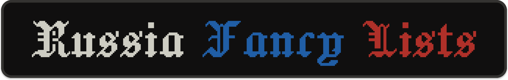
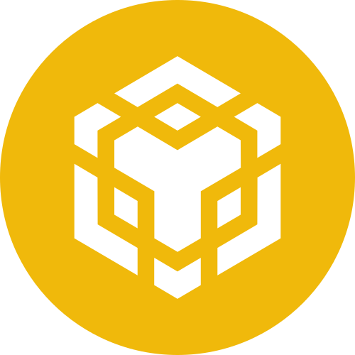

<div align="center">
  
  <p>В данном репозитории публикуются и автоматически обновляются списки доменов и IP-адресов, доступ к которым ограничен или замедлен на территории РФ. Отлично подходит для домашней лаборатории, VPN-шлюзов или кастомных правил маршрутизации.</p>
  <p>
    <picture><source media="(prefers-color-scheme: dark)" srcset="https://www.shieldcn.dev/github/stars/Noktomezo/RussiaFancyLists.svg?variant=secondary&size=xs&mode=dark&theme=neutral&font=geist-mono"></picture>
    <picture><source media="(prefers-color-scheme: dark)" srcset="https://www.shieldcn.dev/github/last-commit/Noktomezo/RussiaFancyLists.svg?variant=secondary&size=xs&mode=dark&theme=neutral&font=geist-mono"></picture>
    <picture><source media="(prefers-color-scheme: dark)" srcset="https://www.shieldcn.dev/github/commits/Noktomezo/RussiaFancyLists.svg?variant=secondary&size=xs&mode=dark&theme=neutral&font=geist-mono"></picture>
    <picture><source media="(prefers-color-scheme: dark)" srcset="https://www.shieldcn.dev/github/license/Noktomezo/RussiaFancyLists.svg?variant=ghost&size=xs&mode=dark&theme=neutral&font=geist-mono"></picture>
  </p>
  <p><a href="README.md">🇬🇧 English</a> • 🇷🇺 <b>Русский</b></p>
</div>

## 👀 Содержимое списков

> [!NOTE]
> 🤖 **Автоматическое обновление**: Списки обновляются каждые 3 часа (включая 21:00 UTC / 00:00 GMT+3 — московское время) с помощью GitHub Actions. Пуш происходит только при фактическом изменении списков.

Сгенерированные списки организованы следующим образом:

<table width="100%">
  <thead>
    <tr>
      <th width="120" align="center"><b>Категория</b></th>
      <th width="110" align="center"><b>Вариант</b></th>
      <th width="100" align="center"><b>Тип</b></th>
      <th width="450" align="center"><b>Файлы</b></th>
      <th width="220" align="center"><b>Размер</b></th>
    </tr>
  </thead>
  <tbody>
    <tr>
      <td rowspan="6"><b>Чёрный список</b></td>
      <td rowspan="2"><b>Текст</b></td>
      <td><b>Домены</b></td>
      <td>
        • <a href="https://raw.githubusercontent.com/Noktomezo/RussiaFancyLists/main/lists/blacklist/domains/full.lst"><code>full.lst</code></a><br>
        • <a href="https://raw.githubusercontent.com/Noktomezo/RussiaFancyLists/main/lists/blacklist/domains/full-sld.lst"><code>full-sld.lst</code></a>
      </td>
      <td>
        • <!-- SIZE:lists/blacklist/domains/full.lst -->unknown<!-- SIZE_END --><br>
        • <!-- SIZE:lists/blacklist/domains/full-sld.lst -->unknown<!-- SIZE_END -->
      </td>
    </tr>
    <tr>
      <td><b>IP-сети</b></td>
      <td>
        • <a href="https://raw.githubusercontent.com/Noktomezo/RussiaFancyLists/main/lists/blacklist/ipsets/full.lst"><code>full.lst</code></a><br>
        • <a href="https://raw.githubusercontent.com/Noktomezo/RussiaFancyLists/main/lists/blacklist/ipsets/full-and-cdn.lst"><code>full-and-cdn.lst</code></a><br>
        • <a href="https://raw.githubusercontent.com/Noktomezo/RussiaFancyLists/main/lists/blacklist/ipsets/cdn.lst"><code>cdn.lst</code></a>
      </td>
      <td>
        • <!-- SIZE:lists/blacklist/ipsets/full.lst -->unknown<!-- SIZE_END --><br>
        • <!-- SIZE:lists/blacklist/ipsets/full-and-cdn.lst -->unknown<!-- SIZE_END --><br>
        • <!-- SIZE:lists/blacklist/ipsets/cdn.lst -->unknown<!-- SIZE_END -->
      </td>
    </tr>
    <tr>
      <td rowspan="2"><b>sing-box</b></td>
      <td><b>Домены</b></td>
      <td>
        • <a href="https://raw.githubusercontent.com/Noktomezo/RussiaFancyLists/main/lists/blacklist-sing-box/domains/full.json"><code>full.json</code></a><br>
        • <a href="https://raw.githubusercontent.com/Noktomezo/RussiaFancyLists/main/lists/blacklist-sing-box/domains/full.srs"><code>full.srs</code></a><br>
        • <a href="https://raw.githubusercontent.com/Noktomezo/RussiaFancyLists/main/lists/blacklist-sing-box/domains/full-sld.json"><code>full-sld.json</code></a><br>
        • <a href="https://raw.githubusercontent.com/Noktomezo/RussiaFancyLists/main/lists/blacklist-sing-box/domains/full-sld.srs"><code>full-sld.srs</code></a>
      </td>
      <td>
        • <!-- SIZE:lists/blacklist-sing-box/domains/full.json -->unknown<!-- SIZE_END --><br>
        • <!-- SIZE:lists/blacklist-sing-box/domains/full.srs -->unknown<!-- SIZE_END --><br>
        • <!-- SIZE:lists/blacklist-sing-box/domains/full-sld.json -->unknown<!-- SIZE_END --><br>
        • <!-- SIZE:lists/blacklist-sing-box/domains/full-sld.srs -->unknown<!-- SIZE_END -->
      </td>
    </tr>
    <tr>
      <td><b>IP-сети</b></td>
      <td>
        • <a href="https://raw.githubusercontent.com/Noktomezo/RussiaFancyLists/main/lists/blacklist-sing-box/ipsets/full.json"><code>full.json</code></a><br>
        • <a href="https://raw.githubusercontent.com/Noktomezo/RussiaFancyLists/main/lists/blacklist-sing-box/ipsets/full.srs"><code>full.srs</code></a><br>
        • <a href="https://raw.githubusercontent.com/Noktomezo/RussiaFancyLists/main/lists/blacklist-sing-box/ipsets/full-and-cdn.json"><code>full-and-cdn.json</code></a><br>
        • <a href="https://raw.githubusercontent.com/Noktomezo/RussiaFancyLists/main/lists/blacklist-sing-box/ipsets/full-and-cdn.srs"><code>full-and-cdn.srs</code></a><br>
        • <a href="https://raw.githubusercontent.com/Noktomezo/RussiaFancyLists/main/lists/blacklist-sing-box/ipsets/cdn.json"><code>cdn.json</code></a><br>
        • <a href="https://raw.githubusercontent.com/Noktomezo/RussiaFancyLists/main/lists/blacklist-sing-box/ipsets/cdn.srs"><code>cdn.srs</code></a>
      </td>
      <td>
        • <!-- SIZE:lists/blacklist-sing-box/ipsets/full.json -->unknown<!-- SIZE_END --><br>
        • <!-- SIZE:lists/blacklist-sing-box/ipsets/full.srs -->unknown<!-- SIZE_END --><br>
        • <!-- SIZE:lists/blacklist-sing-box/ipsets/full-and-cdn.json -->unknown<!-- SIZE_END --><br>
        • <!-- SIZE:lists/blacklist-sing-box/ipsets/full-and-cdn.srs -->unknown<!-- SIZE_END --><br>
        • <!-- SIZE:lists/blacklist-sing-box/ipsets/cdn.json -->unknown<!-- SIZE_END --><br>
        • <!-- SIZE:lists/blacklist-sing-box/ipsets/cdn.srs -->unknown<!-- SIZE_END -->
      </td>
    </tr>
    <tr>
      <td rowspan="2"><b>Mihomo</b></td>
      <td><b>Домены</b></td>
      <td>
        • <a href="https://raw.githubusercontent.com/Noktomezo/RussiaFancyLists/main/lists/blacklist-mihomo/domains/full.yaml"><code>full.yaml</code></a><br>
        • <a href="https://raw.githubusercontent.com/Noktomezo/RussiaFancyLists/main/lists/blacklist-mihomo/domains/full.mrs"><code>full.mrs</code></a><br>
        • <a href="https://raw.githubusercontent.com/Noktomezo/RussiaFancyLists/main/lists/blacklist-mihomo/domains/full-sld.yaml"><code>full-sld.yaml</code></a><br>
        • <a href="https://raw.githubusercontent.com/Noktomezo/RussiaFancyLists/main/lists/blacklist-mihomo/domains/full-sld.mrs"><code>full-sld.mrs</code></a>
      </td>
      <td>
        • <!-- SIZE:lists/blacklist-mihomo/domains/full.yaml -->unknown<!-- SIZE_END --><br>
        • <!-- SIZE:lists/blacklist-mihomo/domains/full.mrs -->unknown<!-- SIZE_END --><br>
        • <!-- SIZE:lists/blacklist-mihomo/domains/full-sld.yaml -->unknown<!-- SIZE_END --><br>
        • <!-- SIZE:lists/blacklist-mihomo/domains/full-sld.mrs -->unknown<!-- SIZE_END -->
      </td>
    </tr>
    <tr>
      <td><b>IP-сети</b></td>
      <td>
        • <a href="https://raw.githubusercontent.com/Noktomezo/RussiaFancyLists/main/lists/blacklist-mihomo/ipsets/full.yaml"><code>full.yaml</code></a><br>
        • <a href="https://raw.githubusercontent.com/Noktomezo/RussiaFancyLists/main/lists/blacklist-mihomo/ipsets/full.mrs"><code>full.mrs</code></a><br>
        • <a href="https://raw.githubusercontent.com/Noktomezo/RussiaFancyLists/main/lists/blacklist-mihomo/ipsets/full-and-cdn.yaml"><code>full-and-cdn.yaml</code></a><br>
        • <a href="https://raw.githubusercontent.com/Noktomezo/RussiaFancyLists/main/lists/blacklist-mihomo/ipsets/full-and-cdn.mrs"><code>full-and-cdn.mrs</code></a><br>
        • <a href="https://raw.githubusercontent.com/Noktomezo/RussiaFancyLists/main/lists/blacklist-mihomo/ipsets/cdn.yaml"><code>cdn.yaml</code></a><br>
        • <a href="https://raw.githubusercontent.com/Noktomezo/RussiaFancyLists/main/lists/blacklist-mihomo/ipsets/cdn.mrs"><code>cdn.mrs</code></a>
      </td>
      <td>
        • <!-- SIZE:lists/blacklist-mihomo/ipsets/full.yaml -->unknown<!-- SIZE_END --><br>
        • <!-- SIZE:lists/blacklist-mihomo/ipsets/full.mrs -->unknown<!-- SIZE_END --><br>
        • <!-- SIZE:lists/blacklist-mihomo/ipsets/full-and-cdn.yaml -->unknown<!-- SIZE_END --><br>
        • <!-- SIZE:lists/blacklist-mihomo/ipsets/full-and-cdn.mrs -->unknown<!-- SIZE_END --><br>
        • <!-- SIZE:lists/blacklist-mihomo/ipsets/cdn.yaml -->unknown<!-- SIZE_END --><br>
        • <!-- SIZE:lists/blacklist-mihomo/ipsets/cdn.mrs -->unknown<!-- SIZE_END -->
      </td>
    </tr>
    <tr>
      <td rowspan="3"><b>Геоблокировки</b></td>
      <td><b>Текст</b></td>
      <td><b>Домены</b></td>
      <td>
        • <a href="https://raw.githubusercontent.com/Noktomezo/RussiaFancyLists/main/lists/geoblock/full.lst"><code>full.lst</code></a><br>
        • <a href="https://raw.githubusercontent.com/Noktomezo/RussiaFancyLists/main/lists/geoblock/full-sld.lst"><code>full-sld.lst</code></a>
      </td>
      <td>
        • <!-- SIZE:lists/geoblock/full.lst -->22.2 KB<!-- SIZE_END --><br>
        • <!-- SIZE:lists/geoblock/full-sld.lst -->13.3 KB<!-- SIZE_END -->
      </td>
    </tr>
    <tr>
      <td><b>sing-box</b></td>
      <td><b>Домены</b></td>
      <td>
        • <a href="https://raw.githubusercontent.com/Noktomezo/RussiaFancyLists/main/lists/geoblock-sing-box/full.json"><code>full.json</code></a><br>
        • <a href="https://raw.githubusercontent.com/Noktomezo/RussiaFancyLists/main/lists/geoblock-sing-box/full.srs"><code>full.srs</code></a><br>
        • <a href="https://raw.githubusercontent.com/Noktomezo/RussiaFancyLists/main/lists/geoblock-sing-box/full-sld.json"><code>full-sld.json</code></a><br>
        • <a href="https://raw.githubusercontent.com/Noktomezo/RussiaFancyLists/main/lists/geoblock-sing-box/full-sld.srs"><code>full-sld.srs</code></a>
      </td>
      <td>
        • <!-- SIZE:lists/geoblock-sing-box/full.json -->unknown<!-- SIZE_END --><br>
        • <!-- SIZE:lists/geoblock-sing-box/full.srs -->unknown<!-- SIZE_END --><br>
        • <!-- SIZE:lists/geoblock-sing-box/full-sld.json -->unknown<!-- SIZE_END --><br>
        • <!-- SIZE:lists/geoblock-sing-box/full-sld.srs -->unknown<!-- SIZE_END -->
      </td>
    </tr>
    <tr>
      <td><b>Mihomo</b></td>
      <td><b>Домены</b></td>
      <td>
        • <a href="https://raw.githubusercontent.com/Noktomezo/RussiaFancyLists/main/lists/geoblock-mihomo/full.yaml"><code>full.yaml</code></a><br>
        • <a href="https://raw.githubusercontent.com/Noktomezo/RussiaFancyLists/main/lists/geoblock-mihomo/full.mrs"><code>full.mrs</code></a><br>
        • <a href="https://raw.githubusercontent.com/Noktomezo/RussiaFancyLists/main/lists/geoblock-mihomo/full-sld.yaml"><code>full-sld.yaml</code></a><br>
        • <a href="https://raw.githubusercontent.com/Noktomezo/RussiaFancyLists/main/lists/geoblock-mihomo/full-sld.mrs"><code>full-sld.mrs</code></a>
      </td>
      <td>
        • <!-- SIZE:lists/geoblock-mihomo/full.yaml -->unknown<!-- SIZE_END --><br>
        • <!-- SIZE:lists/geoblock-mihomo/full.mrs -->unknown<!-- SIZE_END --><br>
        • <!-- SIZE:lists/geoblock-mihomo/full-sld.yaml -->unknown<!-- SIZE_END --><br>
        • <!-- SIZE:lists/geoblock-mihomo/full-sld.mrs -->unknown<!-- SIZE_END -->
      </td>
    </tr>
    <tr>
      <td rowspan="6"><b>Белый список</b></td>
      <td rowspan="2"><b>Текст</b></td>
      <td><b>Домены</b></td>
      <td>
        • <a href="https://raw.githubusercontent.com/Noktomezo/RussiaFancyLists/main/lists/whitelist/domains.lst"><code>domains.lst</code></a>
      </td>
      <td>
        • <!-- SIZE:lists/whitelist/domains.lst -->unknown<!-- SIZE_END -->
      </td>
    </tr>
    <tr>
      <td><b>IP-сети</b></td>
      <td>
        • <a href="https://raw.githubusercontent.com/Noktomezo/RussiaFancyLists/main/lists/whitelist/ipset.lst"><code>ipset.lst</code></a><br>
        • <a href="https://raw.githubusercontent.com/Noktomezo/RussiaFancyLists/main/lists/whitelist/cidr.lst"><code>cidr.lst</code></a>
      </td>
      <td>
        • <!-- SIZE:lists/whitelist/ipset.lst -->unknown<!-- SIZE_END --><br>
        • <!-- SIZE:lists/whitelist/cidr.lst -->unknown<!-- SIZE_END -->
      </td>
    </tr>
    <tr>
      <td rowspan="2"><b>sing-box</b></td>
      <td><b>Домены</b></td>
      <td>
        • <a href="https://raw.githubusercontent.com/Noktomezo/RussiaFancyLists/main/lists/whitelist-sing-box/domains.json"><code>domains.json</code></a><br>
        • <a href="https://raw.githubusercontent.com/Noktomezo/RussiaFancyLists/main/lists/whitelist-sing-box/domains.srs"><code>domains.srs</code></a>
      </td>
      <td>
        • <!-- SIZE:lists/whitelist-sing-box/domains.json -->unknown<!-- SIZE_END --><br>
        • <!-- SIZE:lists/whitelist-sing-box/domains.srs -->unknown<!-- SIZE_END -->
      </td>
    </tr>
    <tr>
      <td><b>IP-сети</b></td>
      <td>
        • <a href="https://raw.githubusercontent.com/Noktomezo/RussiaFancyLists/main/lists/whitelist-sing-box/ipset.json"><code>ipset.json</code></a><br>
        • <a href="https://raw.githubusercontent.com/Noktomezo/RussiaFancyLists/main/lists/whitelist-sing-box/ipset.srs"><code>ipset.srs</code></a><br>
        • <a href="https://raw.githubusercontent.com/Noktomezo/RussiaFancyLists/main/lists/whitelist-sing-box/cidr.json"><code>cidr.json</code></a><br>
        • <a href="https://raw.githubusercontent.com/Noktomezo/RussiaFancyLists/main/lists/whitelist-sing-box/cidr.srs"><code>cidr.srs</code></a>
      </td>
      <td>
        • <!-- SIZE:lists/whitelist-sing-box/ipset.json -->unknown<!-- SIZE_END --><br>
        • <!-- SIZE:lists/whitelist-sing-box/ipset.srs -->unknown<!-- SIZE_END --><br>
        • <!-- SIZE:lists/whitelist-sing-box/cidr.json -->unknown<!-- SIZE_END --><br>
        • <!-- SIZE:lists/whitelist-sing-box/cidr.srs -->unknown<!-- SIZE_END -->
      </td>
    </tr>
    <tr>
      <td rowspan="2"><b>Mihomo</b></td>
      <td><b>Домены</b></td>
      <td>
        • <a href="https://raw.githubusercontent.com/Noktomezo/RussiaFancyLists/main/lists/whitelist-mihomo/domains.yaml"><code>domains.yaml</code></a><br>
        • <a href="https://raw.githubusercontent.com/Noktomezo/RussiaFancyLists/main/lists/whitelist-mihomo/domains.mrs"><code>domains.mrs</code></a>
      </td>
      <td>
        • <!-- SIZE:lists/whitelist-mihomo/domains.yaml -->unknown<!-- SIZE_END --><br>
        • <!-- SIZE:lists/whitelist-mihomo/domains.mrs -->unknown<!-- SIZE_END -->
      </td>
    </tr>
    <tr>
      <td><b>IP-сети</b></td>
      <td>
        • <a href="https://raw.githubusercontent.com/Noktomezo/RussiaFancyLists/main/lists/whitelist-mihomo/ipset.yaml"><code>ipset.yaml</code></a><br>
        • <a href="https://raw.githubusercontent.com/Noktomezo/RussiaFancyLists/main/lists/whitelist-mihomo/ipset.mrs"><code>ipset.mrs</code></a><br>
        • <a href="https://raw.githubusercontent.com/Noktomezo/RussiaFancyLists/main/lists/whitelist-mihomo/cidr.yaml"><code>cidr.yaml</code></a><br>
        • <a href="https://raw.githubusercontent.com/Noktomezo/RussiaFancyLists/main/lists/whitelist-mihomo/cidr.mrs"><code>cidr.mrs</code></a>
      </td>
      <td>
        • <!-- SIZE:lists/whitelist-mihomo/ipset.yaml -->unknown<!-- SIZE_END --><br>
        • <!-- SIZE:lists/whitelist-mihomo/ipset.mrs -->unknown<!-- SIZE_END --><br>
        • <!-- SIZE:lists/whitelist-mihomo/cidr.yaml -->unknown<!-- SIZE_END --><br>
        • <!-- SIZE:lists/whitelist-mihomo/cidr.mrs -->unknown<!-- SIZE_END -->
      </td>
    </tr>
    <tr>
      <td rowspan="3"><b>Служебные</b></td>
      <td><b>Текст</b></td>
      <td><b>Домены</b></td>
      <td>
        • <a href="https://raw.githubusercontent.com/Noktomezo/RussiaFancyLists/main/lists/service/prefer-direct.lst"><code>prefer-direct.lst</code></a><br>
        • <a href="https://raw.githubusercontent.com/Noktomezo/RussiaFancyLists/main/lists/service/direct-with-ech.lst"><code>direct-with-ech.lst</code></a>
      </td>
      <td>
        • <!-- SIZE:lists/service/prefer-direct.lst -->unknown<!-- SIZE_END --><br>
        • <!-- SIZE:lists/service/direct-with-ech.lst -->unknown<!-- SIZE_END -->
      </td>
    </tr>
    <tr>
      <td><b>sing-box</b></td>
      <td><b>Домены</b></td>
      <td>
        • <a href="https://raw.githubusercontent.com/Noktomezo/RussiaFancyLists/main/lists/service-sing-box/prefer-direct.json"><code>prefer-direct.json</code></a><br>
        • <a href="https://raw.githubusercontent.com/Noktomezo/RussiaFancyLists/main/lists/service-sing-box/prefer-direct.srs"><code>prefer-direct.srs</code></a><br>
        • <a href="https://raw.githubusercontent.com/Noktomezo/RussiaFancyLists/main/lists/service-sing-box/direct-with-ech.json"><code>direct-with-ech.json</code></a><br>
        • <a href="https://raw.githubusercontent.com/Noktomezo/RussiaFancyLists/main/lists/service-sing-box/direct-with-ech.srs"><code>direct-with-ech.srs</code></a>
      </td>
      <td>
        • <!-- SIZE:lists/service-sing-box/prefer-direct.json -->unknown<!-- SIZE_END --><br>
        • <!-- SIZE:lists/service-sing-box/prefer-direct.srs -->unknown<!-- SIZE_END --><br>
        • <!-- SIZE:lists/service-sing-box/direct-with-ech.json -->unknown<!-- SIZE_END --><br>
        • <!-- SIZE:lists/service-sing-box/direct-with-ech.srs -->unknown<!-- SIZE_END -->
      </td>
    </tr>
    <tr>
      <td><b>Mihomo</b></td>
      <td><b>Домены</b></td>
      <td>
        • <a href="https://raw.githubusercontent.com/Noktomezo/RussiaFancyLists/main/lists/service-mihomo/prefer-direct.yaml"><code>prefer-direct.yaml</code></a><br>
        • <a href="https://raw.githubusercontent.com/Noktomezo/RussiaFancyLists/main/lists/service-mihomo/prefer-direct.mrs"><code>prefer-direct.mrs</code></a><br>
        • <a href="https://raw.githubusercontent.com/Noktomezo/RussiaFancyLists/main/lists/service-mihomo/direct-with-ech.yaml"><code>direct-with-ech.yaml</code></a><br>
        • <a href="https://raw.githubusercontent.com/Noktomezo/RussiaFancyLists/main/lists/service-mihomo/direct-with-ech.mrs"><code>direct-with-ech.mrs</code></a>
      </td>
      <td>
        • <!-- SIZE:lists/service-mihomo/prefer-direct.yaml -->unknown<!-- SIZE_END --><br>
        • <!-- SIZE:lists/service-mihomo/prefer-direct.mrs -->unknown<!-- SIZE_END --><br>
        • <!-- SIZE:lists/service-mihomo/direct-with-ech.yaml -->unknown<!-- SIZE_END --><br>
        • <!-- SIZE:lists/service-mihomo/direct-with-ech.mrs -->unknown<!-- SIZE_END -->
      </td>
    </tr>
  </tbody>
</table>

> [!TIP]
> **💡 Подробное описание категорий и списков:**
> Полную информацию о назначении каждого списка (включая служебные `prefer-direct` и `direct-with-ech`) читайте в нашей [Базе знаний: Категории списков](https://github.com/Noktomezo/RussiaFancyLists/wiki/List-Categories).

## 🌐 Бесплатный и надежный обход геоблокировок

> [!TIP]
> **🚀 Быстрый старт через DoH (DNS over HTTPS):**
> Чтобы не скачивать файлы `hosts` и не настраивать AdGuard Home, можно просто использовать готовый защищённый DNS-сервер:
> ```text
> https://ys39tfku2v.cloudflare-gateway.com/dns-query
> ```
> Вставьте этот адрес в настройки «Безопасный DNS» в браузере, в параметры DoH вашего роутера или прокси-клиента (sing-box, Mihomo, Clash, AdGuard). Заблокированные и геоблокируемые сервисы будут открываться автоматически, а все остальные сайты продолжат работать напрямую через быстрый Cloudflare DNS.
>
> 📖 Полное руководство по настройке (включая OpenWrt, связку с Zapret и исправление утечек IPv6/браузеров) доступно в [Базе знаний: Настройка DNS](https://github.com/Noktomezo/RussiaFancyLists/wiki/DNS-Setup) и [Решение проблем](https://github.com/Noktomezo/RussiaFancyLists/wiki/Troubleshooting).

Готовые файлы `hosts` и правила Smart DNS для обхода геоблокировок и локальной цензуры:

<!-- HOSTS_TABLE_START -->
<table width="100%">
  <thead>
    <tr>
      <th width="120" align="center"><b>Формат</b></th>
      <th width="180" align="center"><b>Назначение</b></th>
      <th width="370" align="center"><b>Файлы</b></th>
      <th width="150" align="center"><b>Размер</b></th>
      <th width="180" align="center"><b>Покрытие геоблоков</b></th>
    </tr>
  </thead>
  <tbody>
    <tr>
      <td rowspan="4"><b>Hosts</b></td>
      <td><b>Smart</b>&nbsp;❤️</td>
      <td>
        • <a href="https://raw.githubusercontent.com/Psychosoc1al/RussiaFancyLists/bezmezhau/lists/hosts/smart.hosts"><code>smart.hosts</code></a><br>
        • <a href="https://raw.githubusercontent.com/Psychosoc1al/RussiaFancyLists/bezmezhau/lists/hosts/smart-no-crutch.hosts"><code>smart-no-crutch.hosts</code></a>
      </td>
      <td>
        • <!-- SIZE:lists/hosts/smart.hosts -->25.2 KB<!-- SIZE_END --><br>
        • <!-- SIZE:lists/hosts/smart-no-crutch.hosts -->22.8 KB<!-- SIZE_END -->
      </td>
      <td>
        • 475/1517<br>
        • 475/1517
      </td>
    </tr>
    <tr>
      <td><b>Combined</b>&nbsp;⚠️</td>
      <td>
        • <a href="https://raw.githubusercontent.com/Psychosoc1al/RussiaFancyLists/bezmezhau/lists/hosts/combined.hosts"><code>combined.hosts</code></a><br>
        • <a href="https://raw.githubusercontent.com/Psychosoc1al/RussiaFancyLists/bezmezhau/lists/hosts/combined-no-crutch.hosts"><code>combined-no-crutch.hosts</code></a>
      </td>
      <td>
        • <!-- SIZE:lists/hosts/combined.hosts -->41.9 KB<!-- SIZE_END --><br>
        • <!-- SIZE:lists/hosts/combined-no-crutch.hosts -->39.5 KB<!-- SIZE_END -->
      </td>
      <td>
        • 1514/1517<br>
        • 1514/1517
      </td>
    </tr>
    <tr>
      <td><b>Bezmezhau</b></td>
      <td>
        • <a href="https://raw.githubusercontent.com/Psychosoc1al/RussiaFancyLists/bezmezhau/lists/hosts/bezmezhau.hosts"><code>bezmezhau.hosts</code></a><br>
        • <a href="https://raw.githubusercontent.com/Psychosoc1al/RussiaFancyLists/bezmezhau/lists/hosts/bezmezhau-no-crutch.hosts"><code>bezmezhau-no-crutch.hosts</code></a>
      </td>
      <td>
        • <!-- SIZE:lists/hosts/bezmezhau.hosts -->12.5 KB<!-- SIZE_END --><br>
        • <!-- SIZE:lists/hosts/bezmezhau-no-crutch.hosts -->10.1 KB<!-- SIZE_END -->
      </td>
      <td>
        • 436/1517<br>
        • 436/1517
      </td>
    </tr>
    <tr>
      <td><b>Только костыли</b></td>
      <td>
        • <a href="https://raw.githubusercontent.com/Psychosoc1al/RussiaFancyLists/bezmezhau/lists/hosts/only-crutch.hosts"><code>only-crutch.hosts</code></a>
      </td>
      <td>
        • <!-- SIZE:lists/hosts/only-crutch.hosts -->2.5 KB<!-- SIZE_END -->
      </td>
      <td>
        • —
      </td>
    </tr>
    <tr>
      <td rowspan="4"><b>AdGuard Home</b></td>
      <td><b>Smart</b>&nbsp;❤️</td>
      <td>
        • <a href="https://raw.githubusercontent.com/Psychosoc1al/RussiaFancyLists/bezmezhau/lists/hosts/smart.adguard.txt"><code>smart.adguard.txt</code></a><br>
        • <a href="https://raw.githubusercontent.com/Psychosoc1al/RussiaFancyLists/bezmezhau/lists/hosts/smart-no-crutch.adguard.txt"><code>smart-no-crutch.adguard.txt</code></a>
      </td>
      <td>
        • <!-- SIZE:lists/hosts/smart.adguard.txt -->54.1 KB<!-- SIZE_END --><br>
        • <!-- SIZE:lists/hosts/smart-no-crutch.adguard.txt -->48.6 KB<!-- SIZE_END -->
      </td>
      <td>
        • 475/1517<br>
        • 475/1517
      </td>
    </tr>
    <tr>
      <td><b>Combined</b>&nbsp;⚠️</td>
      <td>
        • <a href="https://raw.githubusercontent.com/Psychosoc1al/RussiaFancyLists/bezmezhau/lists/hosts/combined.adguard.txt"><code>combined.adguard.txt</code></a><br>
        • <a href="https://raw.githubusercontent.com/Psychosoc1al/RussiaFancyLists/bezmezhau/lists/hosts/combined-no-crutch.adguard.txt"><code>combined-no-crutch.adguard.txt</code></a>
      </td>
      <td>
        • <!-- SIZE:lists/hosts/combined.adguard.txt -->84.2 KB<!-- SIZE_END --><br>
        • <!-- SIZE:lists/hosts/combined-no-crutch.adguard.txt -->78.6 KB<!-- SIZE_END -->
      </td>
      <td>
        • 1514/1517<br>
        • 1514/1517
      </td>
    </tr>
    <tr>
      <td><b>Bezmezhau</b></td>
      <td>
        • <a href="https://raw.githubusercontent.com/Psychosoc1al/RussiaFancyLists/bezmezhau/lists/hosts/bezmezhau.adguard.txt"><code>bezmezhau.adguard.txt</code></a><br>
        • <a href="https://raw.githubusercontent.com/Psychosoc1al/RussiaFancyLists/bezmezhau/lists/hosts/bezmezhau-no-crutch.adguard.txt"><code>bezmezhau-no-crutch.adguard.txt</code></a>
      </td>
      <td>
        • <!-- SIZE:lists/hosts/bezmezhau.adguard.txt -->29.1 KB<!-- SIZE_END --><br>
        • <!-- SIZE:lists/hosts/bezmezhau-no-crutch.adguard.txt -->23.6 KB<!-- SIZE_END -->
      </td>
      <td>
        • 436/1517<br>
        • 436/1517
      </td>
    </tr>
    <tr>
      <td><b>Только костыли</b></td>
      <td>
        • <a href="https://raw.githubusercontent.com/Psychosoc1al/RussiaFancyLists/bezmezhau/lists/hosts/only-crutch.adguard.txt"><code>only-crutch.adguard.txt</code></a>
      </td>
      <td>
        • <!-- SIZE:lists/hosts/only-crutch.adguard.txt -->5.7 KB<!-- SIZE_END -->
      </td>
      <td>
        • —
      </td>
    </tr>
  </tbody>
</table>
<!-- HOSTS_TABLE_END -->

> [!TIP]
> **💡 Подробный разбор форматов и альтернатив:**<br>
> • Разницу между `smart` и `combined`, синтаксис AdGuard Home и назначение секции `# Crutch` («костыли») читайте в [Базе знаний: Hosts и AdGuard](https://github.com/Noktomezo/RussiaFancyLists/wiki/Hosts-and-AdGuard).<br>
> • Альтернативы для 100% покрытия геоблоков (WARP Relay, Proton, Warpscout, личный VPS) описаны в [Базе знаний: Альтернативы для геоблока](https://github.com/Noktomezo/RussiaFancyLists/wiki/Geoblock-Alternatives).

## ⚡ Статус Smart DNS
<!-- STATUS_START -->
- **Bezmezhau**: 💚💚

> [!NOTE]
> Каждое сердечко обозначает доступный IP-адрес сервера Smart DNS (💚).
>
> *Примечание по Xbox DNS:* Проект **Xbox DNS** является независимым сервисом сообщества для доступа к игровым платформам (Xbox Live, PSN) и различным геозаблокированным сервисам; он **никак не аффилирован с Microsoft Corporation**.
<!-- STATUS_END -->

## 🔗 Источники

💜 [Antifilter Domain List](https://antifilter.download/list/domains.lst) — список заблокированных доменов от antifilter.download<br>
💜 [Antifilter Community Domain List](https://community.antifilter.download/list/domains.lst) — общественный список заблокированных доменов<br>
💜 [Re:filter Domain List](https://raw.githubusercontent.com/1andrevich/Re-filter-lists/refs/heads/main/domains_all.lst) — альтернативный отечественный список доменов<br>
💜 [Antifilter IPSet](https://antifilter.download/list/allyouneed.lst) — полный список заблокированных подсетей IP<br>
💜 [Antifilter Community IPSet](https://community.antifilter.download/list/community.lst) — общественный список заблокированных подсетей IP<br>
💜 [Antifilter Extra IPSet](https://antifilter.download/list/ipresolve.lst) — разрешенные IP-адреса заблокированных ресурсов<br>
💜 [Re:filter IPSet](https://github.com/1andrevich/Re-filter-lists/raw/refs/heads/main/ipsum.lst) — компиляция подсетей IP отечественных списков<br>
💜 [ImMALWARE's Hosts](https://raw.githubusercontent.com/ImMALWARE/dns.malw.link/refs/heads/master/hosts) — адреса публичных Smart DNS серверов от ImMALWARE<br>
💜 [GeoHide's Hosts](https://raw.githubusercontent.com/Internet-Helper/GeoHideDNS/refs/heads/main/hosts/hosts) — адреса публичных Smart DNS серверов от GeoHide<br>
💜 [ItDogInfo's Geoblock Domains](https://raw.githubusercontent.com/itdoginfo/allow-domains/refs/heads/main/Categories/geoblock.lst) — список доменов геоблока от itdog.info<br>
💜 [Службы с геоблокировками от Dartraiden](https://raw.githubusercontent.com/dartraiden/no-russia-hosts/refs/heads/master/hosts.txt) — список доменов сервисов, блокирующих РФ<br>
💜 [Zapret-Manager Shell Script](https://raw.githubusercontent.com/StressOzz/Zapret-Manager/refs/heads/main/Zapret-Manager.sh) — переменные различных заблокированных сервисов<br>
💜 [Исключения Zapret-Manager](https://raw.githubusercontent.com/StressOzz/Zapret-Manager/refs/heads/main/zapret-hosts-user-exclude.txt) — список доменов-исключений от Zapret-Manager<br>
💜 [singbox-ech-list](https://github.com/Akiyamov/singbox-ech-list) — список заблокированных доменов с поддержкой Encrypted Client Hello (ECH)<br>
💜 [CDN IP Ranges](https://raw.githubusercontent.com/123jjck/cdn-ip-ranges/refs/heads/main/all/all_plain_ipv4.txt) — диапазоны IP-адресов глобальных CDN<br>
💜 [CDN IP Database](https://raw.githubusercontent.com/mansourjabin/cdn-ip-database/refs/heads/main/data/cdn.lst) — база IP-адресов глобальных CDN<br>
💜 [sing-box](https://github.com/SagerNet/sing-box) — универсальное ядро прокси от SagerNet (хранится в `thirdparty/sing-box`)<br>
💜 [mihomo](https://github.com/MetaCubeX/mihomo) — ядро прокси-клиента (преемник Clash) от MetaCubeX (хранится в `thirdparty/mihomo`)

## 💖 Поддержка

Если проект оказался для вас полезным, вы можете поддержать его развитие и инфраструктуру:

Fiat:<br>
<sub></sub> <sub></sub> [Пожертвование в любой валюте](https://dalink.to/nxktxmezx) (Банковские карты, СБП, T-Pay и др.)

Crypto:<br>
<sub></sub> **USDT (TRC20)** — `TEk8zn5hq41p3oECQyyUveSSy1n44FuWxA`<br>
<sub></sub> **USDT (TON)** — `UQBxp5ZfvLr-V0SCPFDjA13qFIxQi6Y5Ga5FdTImaX10IqHO`<br>
<sub></sub> **USDT (SPL)** — `9uxu5dcoBsDNNvjZrTNaJbJd4RXjQNpgunQ4qcDqHfmn`<br>
<sub></sub> **USDT (ERC20)** — `0x207b4c60e8073C50F736dEFf3fe1182F442d95e4`<br>
<sub></sub> **USDT (BEP20)** — `0x207b4c60e8073C50F736dEFf3fe1182F442d95e4`

&nbsp;

<div align="center">
  
  <p>Сделано с 💜. Опубликовано под лицензией <a href="LICENSE">MIT</a>.</p>
</div>
